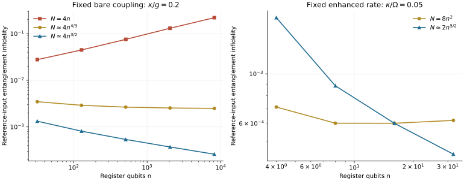

# Quantum Battery Recoverability

**How much excitation must a shared quantum battery hold to power a native gate while preserving an arbitrary quantum register?** This project identifies a recoverability frontier set by the competition between photon-loss information and the speed of native control.

A register of $`n`$ qubits is represented in the fixed-excitation interface

```math
V_N|x\rangle=|x\rangle|N-w(x)\rangle,\qquad N\ge n.
```

The shared oscillator loses photons at rate $`\kappa`$, while each native qubit–battery coupling has magnitude at most $`g`$. Let $`\Omega=g\sqrt N`$. On an operation interval of order $`1/\Omega`$, the controlling parameter is

```math
A=\frac{\kappa n^2}{N\Omega}.
```

Vanishing worst-case error after arbitrary terminal recovery **requires $`A\to0`$**, uniformly over the stated time-dependent native controls. If $`A\to\infty`$, the optimal half-diamond error approaches one. Explicit resonant single-qubit gates, followed by the specified loss-sector decoder, attain the corresponding vanishing-error scales.

| Operating regime | Necessary and achievable scale for vanishing error | Gate construction |
|---|---|---|
| Fixed positive bare coupling $`g`$ and loss rate $`\kappa`$ | $`N/n^{4/3}\to\infty`$ | A constant resonant pulse of duration $`\pi/[2g\sqrt{N-(n-1)/2}]`$. |
| Fixed positive enhanced rate $`\Omega`$ and loss rate $`\kappa`$ | $`N/n^2\to\infty`$ | A depletion-calibrated constant-coupling pulse, for $`\Omega>\pi\kappa/4`$. |

The excitation budget $`N`$ counts register plus battery energy quanta. The lower bound applies to the full dressed input interface over a prescribed native interval. The upper constructions use switchable spectator couplers and an ideal terminal decoder. Finite error bounds, exact quantifiers, and the native gate-duration condition are given in the [model](science/model.md).

## Physical mechanism

Escaping photons reveal register charge because different logical weights correspond to different battery occupations. Bounded native control cannot hide that information immediately. The converse tracks the earliest emitted record and remains valid even when the surviving processor receives arbitrary final recovery.

The logical cost of emission depends on the variation of the loss amplitude across logical states. Many photons can be emitted while decoded error vanishes. First-photon lifetime therefore does not determine logical recoverability. The [physical interpretation](science/interpretation.md) explains this distinction and the role of a hardware speed ceiling.

## Read the science

| To understand or inspect | Read |
|---|---|
| Input interface, control resources, error convention, and exact claims | [Model and results](science/model.md) |
| Count martingale, bounded charge motion, full-channel collapse, and finite crossover bound | [Control converse](science/control-converse.md) |
| The physical resonant gate, exact loss-sector equations, and both operating regimes | [Native gates](science/native-gates.md) |
| Exact idle recovery, ideal input randomization, and maximal protected subspaces | [Passive recovery](science/passive-recovery.md) |
| Energy, speed, decoding costs, and changed encodings | [Interpretation](science/interpretation.md) |
| Inherited results and the nearest operational models | [Related work](references/related-work.md) and [bibliography](references/references.bib) |
| Finite calculations and what they verify | [Verification](verification/README.md) |

[The LLM reading guide](llms.txt) maps questions to the authoritative scientific files.

## Reproduce the finite calculations

From the repository root:

```bash
python3 -m pip install -r verification/requirements.txt
python3 verification/run_checks.py
python3 verification/generate_figures.py
```

The first script checks the passive convex optimization with a supporting-plane certificate, compares independent full Lindblad and loss-sector evolutions, and checks finite reference-input errors against the proved upper bounds. The second regenerates the plotted data and SVG directly from Python.



The plotted quantity is entanglement infidelity for one reference-entangled input under canonical decoding. It is **not** an optimized diamond-norm calculation. Universal converses and asymptotic criteria are established by the proofs, not by the finite sweeps.

## Scope and attribution

The full dressed interface, inaccessible photon-loss bath, bounded exchange, and prescribed native operation interval are essential. A different protected encoding, a mask applied before the input interface, a separate protected memory, or access to the emitted field changes the problem. The scaling at fixed $`g`$ also requires that the growing enhanced rate stay within the applicable Jaynes–Cummings and hardware regime.

The terminal decoder's physical implementation is not priced, and the results do not promise arbitrary circuit depth at a fixed total error. The solvability condition for the pulse at fixed $`\Omega`$ belongs to that construction rather than a universal gate impossibility theorem.

The motivating architecture is due to Kurman et al. Established covariant-QEC, polar-recovery, Pauli-twirling, trajectory, and decoherence-free-subspace results are credited in [Related work](references/related-work.md). The main contribution is the dynamical recoverability bound and its matching native-operation constructions.

## Purpose and contact

This repository serves as a record of the work and a guide for the author’s self-directed learning. For discussion or potential collaboration, please contact Ruge Lin at [gogoko699@gmail.com](mailto:gogoko699@gmail.com).
